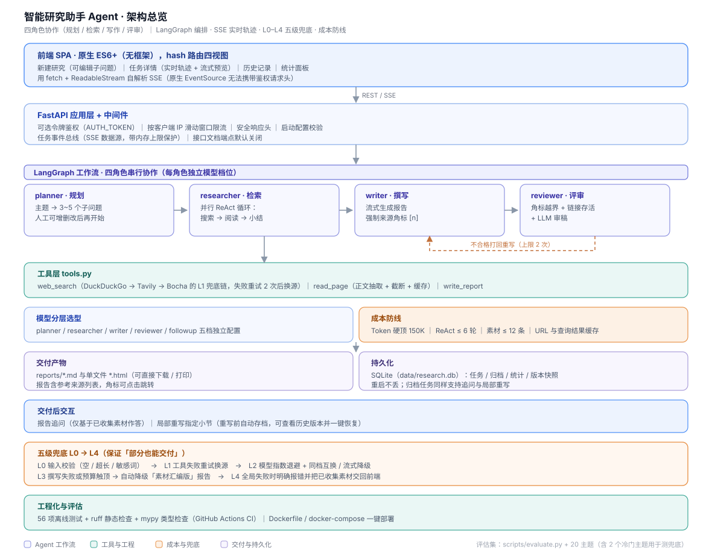

# 智能研究助手 Agent

> 输入一个研究主题，Agent 自主完成 **规划 → 联网检索 → 阅读 → 撰写 → 自检**，交付带参考来源的结构化研究报告，支持**报告追问**、**局部重写（含版本历史与一键恢复）**、**历史记录**与**运行统计**。
>
> 产品设计：[`docs/产品设计方案.md`](docs/产品设计方案.md) ｜ 部署运维：[`docs/部署指南.md`](docs/部署指南.md) ｜ 评估报告：`docs/evaluation-report.md`
> 技术栈：Python 3.10+ / FastAPI / LangGraph / SQLite / OpenAI 兼容接口（DeepSeek / 智谱 GLM 等）/ 原生 HTML5 + CSS3 + JavaScript (ES6+)

## 功能一览

- **可干预的任务规划**：主题 → 子问题清单（3~5 个），可增删改后再开始
- **并行 ReAct 检索**：子问题并发执行"搜索 → 阅读 → 小结"，SSE 实时推送工具调用轨迹与流式撰写预览
- **溯源报告**：强制来源角标 [n] + 参考来源列表；「无来源不陈述」硬规则；可下载 Markdown / HTML / 打印
- **自检打回**：规则核验（角标越界/无引用）+ 链接存活抽查 + LLM 审稿，不合格自动重写（上限 2 次）
- **交付后交互**：报告追问（仅基于素材作答，角标可点击）；局部重写（保留其余小节与来源，重写前自动存档，历史版本可查看与一键恢复）
- **多级兜底 L0–L4**：输入校验 → 工具重试换源 → 模型降级/流式降级 → 素材汇编部分交付 → 全局失败不浪费已收集内容
- **持久化与历史**：任务结果落 SQLite（`data/research.db`），重启不丢；历史分页浏览、查看、下载、删除；运行统计面板（总量/成功率/Token/成本/耗时）
- **企业级安全**：可选 API 令牌鉴权（`AUTH_TOKEN`）、按客户端 IP 滑动窗口限流（写接口合计配额）、接口文档端点默认关闭、前端渲染净化（DOMPurify）、敏感词校验、安全响应头、配置启动校验
- **成本防线**：Token 硬顶、ReAct 循环上限、URL/查询缓存、素材上限；任务级与全局 Token/成本统计
- **评估体系**：20 主题评估集跑分脚本，输出要点支撑率、角标有效率、完成率、成本等指标报告

## 架构



一句话概括：**规划 → 检索 → 写作 → 评审** 四角色串行协作，评审不通过就打回重写；全链路有 L0–L4 五级兜底保证「部分也能交付」；成本由 Token 硬顶、ReAct 轮次上限与缓存三道防线控制。

核心设计（与产品方案一一对应）：

| 设计方案条目 | 实现 |
| --- | --- |
| 模型分层选型（5.1） | `config.yaml` 按 planner/researcher/writer/reviewer/followup 分档 |
| 成本防线（第 6 节） | Token 硬顶 150K、ReAct 循环上限 6 轮、素材上限 12 条、URL/查询缓存 |
| L0 输入校验（7.1） | 空输入 / 超长 / 敏感词，`backend/api/routes.py: validate_topic` |
| L1 工具失败 | 重试 2 次 → 切换搜索源（duckduckgo→tavily→bocha）→ 跳过并标记 |
| L2 模型失败 | 指数退避 ×3 → 同档位备选模型互换；流式失败降级为普通调用 |
| L3 撰写失败/预算触顶 | 自动降级「素材汇编版」报告（不经 LLM，直接由素材拼装） |
| L4 全局失败 | 明确报错 + 已收集素材返回前端（部分交付原则 7.3） |
| 幻觉兜底（7.2） | 「无来源不陈述」角标硬规则 + reviewer 核验 + 打回重写上限 2 次 |
| 进度反馈（3.2③） | SSE 推送 stage/tool/chunk/llm 事件，前端实时渲染轨迹与流式预览 |
| 追问/局部重写（3.2④） | `/api/tasks/{id}/followup`、`/api/tasks/{id}/rewrite`（归档任务同样可用） |
| 评估体系（第 8 节） | `scripts/evaluate.py` + `scripts/eval_topics.json`（20 主题） |

## 快速开始

### 1. 安装依赖

```bash
pip install -r requirements.txt
```

### 2. 配置（可选）

```bash
copy .env.example .env    # 填入 LLM_BASE_URL / LLM_API_KEY / AUTH_TOKEN
```

- **不配置 API Key 也能跑**：自动进入全离线 Mock 模式（LLM 与搜索均为确定性模拟），用于演示与自动化测试。
- 真实搜索默认用 DuckDuckGo（免费，需安装 `ddgs`）；可选填 `TAVILY_API_KEY` / `BOCHA_API_KEY` 作为 L1 备用搜索源。
- 模型档位、Token 预算、限流、敏感词、并发与导出开关在 `config.yaml` 调整。

### 3. 启动

```bash
# 方式一：直接启动
python -m uvicorn backend.main:app --port 8000
# Windows 双击 start.bat / Linux macOS 执行 ./start.sh

# 方式二：Docker Compose（推荐交付方式）
docker compose up -d --build
```

打开 <http://127.0.0.1:8000>：填主题 → 生成研究计划 →（可增删改子问题）→ 开始研究 → 实时进度 → 报告页支持追问/局部重写/下载/打印；左侧标签页切换历史记录与统计。

## API 一览

| 方法 | 路径 | 说明 |
| --- | --- | --- |
| GET | `/api/health` | 健康检查（版本 / 运行中任务数 / 模式），鉴权豁免 |
| GET | `/api/meta` | 模型档位 / 预算 / 鉴权状态 / 版本 |
| POST | `/api/plan` | 主题 → 子问题清单（L0 校验） |
| POST | `/api/research` | 启动研究任务（并发上限 3，写入接口限流） |
| GET | `/api/tasks/{id}/events` | SSE 实时进度（stage/tool/chunk/llm/done/error），归档任务重放 done |
| GET | `/api/tasks/{id}` | 任务状态与结果（内存任务 / 归档任务统一视图，`archived` 标识） |
| DELETE | `/api/tasks/{id}` | 删除任务（记录 + 报告文件；运行中任务拒绝 409） |
| GET | `/api/history` | 历史分页列表（`?q=` 按主题关键词过滤；不含大字段） |
| GET | `/api/stats` | 全局统计（总量/成功率/Token/成本/耗时/运行时长） |
| GET | `/api/tasks/{id}/sections` | 报告小节列表（供局部重写选择） |
| POST | `/api/tasks/{id}/followup` | 报告追问（基于素材作答，返回引用） |
| POST | `/api/tasks/{id}/rewrite` | 局部重写指定小节（快照当前版本，同步落盘与持久化） |
| GET | `/api/tasks/{id}/versions` | 重写版本列表（v1.3） |
| GET | `/api/tasks/{id}/versions/{v}` | 查看指定版本报告内容（v1.3） |
| POST | `/api/tasks/{id}/restore` | 一键恢复到指定版本（恢复前再次自动存档）（v1.3） |
| GET | `/api/reports/{filename}` | 报告 Markdown / HTML 下载 |

启用鉴权后，除 `/api/health` 外所有 `/api/*` 需携带 `X-API-Key: <AUTH_TOKEN>`；接口文档端点（`/docs`、`/redoc`、`/openapi.json`）默认关闭，若通过 `security.expose_docs` 开启也会同样要求令牌。

> 进度流（`/events`）不能用浏览器原生 `EventSource` 订阅——它无法携带自定义请求头，启用鉴权后会被 401 打回。前端已改用 `fetch` + `ReadableStream` 自实现 SSE 解析，令牌经请求头携带，实时轨迹与流式预览在鉴权开启下同样可用。

## 测试与评估

```bash
python -m pytest tests/ -q       # 56 项：单元 / 冒烟（正常、L1、L2 流式降级、L3、L4、重写循环）/ API 集成 / 持久化 / 安全 / 版本历史
node --check frontend/js/app.js  # 前端语法检查（CI 中执行）

# lint 与类型检查（CI 门禁；配置见 pyproject.toml）
pip install -r requirements-dev.txt
python -m ruff check backend tests scripts .
python -m mypy

python scripts/smoke_e2e.py      # 端到端冒烟：真起服务，验证鉴权边界 + 鉴权下的 SSE 实时流（退出码可用于 CI）

# 评估集跑分（Mock 演示；--real 需真实 Key）
python scripts/evaluate.py --count 5 --depth quick
python scripts/evaluate.py --count 20 --real --output docs/evaluation-report.md
```

全部测试离线运行（Mock 模式），无需任何 API Key。

### 评估指标说明

`scripts/evaluate.py` 会拿评估集逐个主题跑完整链路，并输出下列指标（对应产品设计方案第 8 节）：

| 指标 | 含义 |
| --- | --- |
| 完成率 | 成功交付报告的主题数 / 总主题数 |
| 要点支撑率 | 报告中每个要点能否在已收集素材里找到依据（衡量「无来源不陈述」的落实程度） |
| 角标有效率 | 引用角标 `[n]` 是否都落在来源列表范围内，越界即无效 |
| 平均来源数 | 每份报告实际引用的来源条数 |
| 平均 Token 与成本 | 按 `config.yaml` 的 `prices` 单价折算，用于成本回归 |
| 子问题失败总数 / 触发重写总数 | 兜底机制与自检机制被真实触发的次数 |

> ⚠️ **当前仓库里的 `docs/evaluation-report.md` 是 Mock 模式产物**：LLM 与搜索均为确定性模拟（端到端耗时约 0.5s），它只能证明评估脚本本身跑得通，**不代表真实模型效果**。
> 填入 API Key 后跑真实评估即可覆盖该文件：
>
> ```bash
> python scripts/evaluate.py --count 20 --real --output docs/evaluation-report.md
> ```

## 部署

```bash
cp .env.example .env      # 按需填入 API Key 与 AUTH_TOKEN；留空则 Mock 模式
docker compose up -d --build
curl http://127.0.0.1:8000/api/health
```

- 数据持久化：`./reports`（报告文件）与 `./data`（SQLite）双卷挂载，**备份这两个目录即完整备份**
- 健康检查：容器内每 30s 探测 `/api/health`，异常自动重启
- Nginx 反向代理（SSE 需要 `proxy_buffering off`）、systemd、备份恢复、安全清单见 **[`docs/部署指南.md`](docs/部署指南.md)**

## 项目结构

```text
research-agent/
├── config.yaml              # 模型分层 / 预算 / 搜索链 / 限流 / 敏感词 / 导出开关
├── .env.example             # 密钥模板（鉴权 / CORS / 日志 / 数据目录）
├── Dockerfile / docker-compose.yml / start.bat / start.sh
├── .github/workflows/ci.yml # CI：pytest + 前端语法检查
├── backend/
│   ├── config.py            # 配置加载 + validate_settings 启动校验
│   ├── main.py              # FastAPI 入口（鉴权/限流/安全头中间件 + 前端托管）
│   ├── api/routes.py        # 全部 API 路由（含历史/统计/删除/归档回退）
│   ├── agent/
│   │   ├── llm.py           # 分层调用 + L2 兜底 + Token 预算 + Mock
│   │   ├── tools.py         # web_search(L1 链) / read_page(截断+缓存) / write_report
│   │   ├── planner.py       # 主题 → 子问题（支持模板降级）
│   │   ├── researcher.py    # 并行 ReAct 循环，素材去重与截断
│   │   ├── writer.py        # 流式撰写 + L3 素材汇编降级
│   │   ├── reviewer.py      # 规则核验 + 链接存活 + LLM 审稿
│   │   ├── followup.py      # 报告追问 + 局部重写服务
│   │   ├── export.py        # 报告 HTML 单文件导出
│   │   └── graph.py         # LangGraph 编排 + 任务运行器（持久化 + 日志）
│   └── core/
│       ├── events.py        # 任务事件总线（SSE 数据源 + 内存上限保护）
│       ├── storage.py       # SQLite 持久化（历史/归档/统计 + ArchivedTask 适配器）
│       ├── ratelimit.py     # 按 IP 滑动窗口限流
│       └── log.py           # 统一日志
├── frontend/                # SPA：新建/任务详情/历史/统计 四视图（原生 ES6+）
├── scripts/
│   ├── evaluate.py          # 评估集跑分脚本
│   ├── smoke_e2e.py         # 端到端冒烟（真起服务验证鉴权边界与鉴权下的 SSE）
│   └── eval_topics.json     # 20 主题评估集（含 2 个冷门主题测兜底）
├── tests/                   # 56 项离线测试（conftest.py 逐条隔离进程内限流状态）
├── docs/                    # 产品设计方案 / 部署指南 / 评估报告
├── data/                    # SQLite（gitignore，Docker 卷）
└── reports/                 # 生成的报告（gitignore，Docker 卷）
```

## 已知限制

- SQLite 单写者模型：单实例部署完全可用；**横向扩展需引入 Redis/PostgreSQL 共享任务状态**
- Mock 模式为确定性模拟（演示/测试用），不产生真实研究结果
- 搜索源在国内网络环境下可能需要代理；`ddgs` 免费源有限流可能（L1 链会自动切换）
- 成本估算依赖 `config.yaml` 的 `prices`（每百万 Token 单价），未配置则只统计 Token 数
- 限流为进程内状态：多副本部署时每个副本各自计数，需改用网关层限流
- 局部重写/恢复会覆盖报告文件（数据库与磁盘同步更新），历史版本快照保留在 SQLite 中，可随时回退
- 尚未引入代码格式化门禁（black / prettier）；CI 现跑 **ruff 静态检查 + mypy 类型检查 + pytest + 前端语法检查**

## 更新日志

见 [CHANGELOG.md](CHANGELOG.md)。
